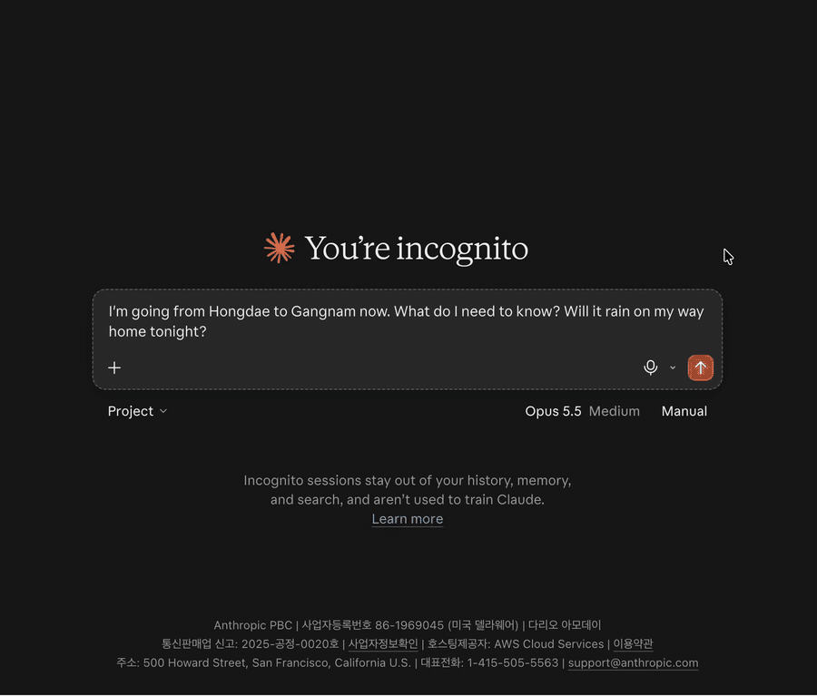

# Seoul Commute MCP

[](https://github.com/Jay02510/seoul-commute-mcp/actions/workflows/tests.yml)

[](LICENSE)

Live Seoul commute data for AI assistants: weather now and later, fine dust,
realtime subway arrivals and timetable-based routes, all from Korean public
data, served over the Model Context Protocol (MCP). The same server also runs
commute briefings that arrive on Telegram every weekday, morning and evening.



*Recorded 2026-11-17, shown at 1.5x speed: route, next trains, weather and forecast at both ends, all from the Cloud Run server.*

**Eval score:** 28/33 with no graded failures; the other 5 hit model outages and are waiting for a rerun (gemini-3.5-flash, see [Evaluation](#evaluation))
· **Tests:** 153, offline, run on every push

## What it does

Ask an assistant "I'm going from Hongdae to Gangnam, anything I should know?"
and it calls the tools below, then answers with real numbers: weather and air
at both ends, the next trains in your direction, the route with stops,
transfers, time and fare, and whether rain is expected on the way home. Every
stop count, journey time and forecast comes from a tool, never from the
model's memory, and the evals check that.

## Tools

| Tool | Source | What it returns |
|---|---|---|
| `current_weather(district)` | KMA 초단기실황 | Temperature, rain now, humidity, wind |
| `forecast(district, hours=12)` | KMA 단기예보 | Hourly temperature, chance of rain, expected rain |
| `air_quality(district)` | AirKorea | PM10 and PM2.5 with Korean hourly grades |
| `next_trains(station, per_direction=2)` | Seoul realtime subway | Next trains per line and direction |
| `route(from_station, to_station, prefer)` | Seoul Metro shortest path | Legs, transfers, stops, timetable times, fare |
| `list_districts()` | built in | The 25 Seoul districts the server covers |

Coverage is Seoul's 25 districts and the Seoul Metro network. Stations work in
Korean (`홍대입구`) or common English (`Hongdae`, `Hongik Univ.`, `Seoul Station`);
districts in English or Korean (`Mapo`, `마포구`).

## Architecture

```
                    ┌────────────────────────────┐
 Claude Desktop ────┤ stdio                      │
                    │                            │      data.go.kr: KMA, AirKorea,
 Claude.ai     ─────┤ Streamable HTTP (token)    │ ───► Seoul Metro route
 (connector)        │  Cloud Run, Seoul region   │      data.seoul.go.kr: subway
                    │                            │
 Briefings ─────────┤ stdio (LLM writer) or      │
 (Cloud Run job)    │ direct calls (rules writer)│
                    └────────────────────────────┘
                         server.py + sources/
```

- `sources/`: one small module per API (`kma`, `airkorea`, `subway`, `route`),
  plain async functions that return dicts. Shared HTTP helper handles
  data.go.kr's habit of answering with XML on key errors.
- `server.py`: the MCP server (Python MCP SDK 2, `MCPServer`). Tool errors are
  caught, redacted and returned as text, so the model can say "unavailable"
  instead of crashing or guessing.
- `http_app.py`: the same server over Streamable HTTP, stateless, behind an
  access token, deployed to Cloud Run in asia-northeast3 (the Korean APIs accept
  Google Cloud Seoul IPs).
- `briefing/`: the Telegram briefing. SQLite stores routes and a send log
  (no double sends), `compose.py` is a rule-based writer, `llm.py` is an MCP
  client that lets Gemini or Claude write the message with the same tools.
  Each route has its own send time. In production it runs as a Cloud Run job
  that Cloud Scheduler starts at 07:45 and 18:00 on weekdays (routes from
  `deploy/routes.json`); on the Mac, launchd does the same with SQLite.

## The morning briefing

Example message (illustrative values):

```
🚇 work: Mapo → Gangnam · Fri 07:45

Weather: Mapo 9.7°C, Gangnam 10.5°C, dry
Later: rain likely from 18:00 in Gangnam (70%)
Air: Mapo PM2.5 29 (moderate), Gangnam PM2.5 26 (moderate)

Next trains, 홍대입구 toward 합정:
• [Line 2] 3분 후
• [Line 2] 6분 50초 후
Journey to 강남: 38 min, 17 stops, no transfers (2호선 toward 합정; timetable 07:50-08:28)

🧥 Cool: bring a jacket.
☂️ Take an umbrella for later (18:00).
```

Design rules:
- **Never reassure about something that was not checked.** "✅ No umbrella or
  mask needed" appears only when weather, forecast and air at both ends all
  answered with a known grade. Anything missing is named in the footer.
- **A route a commuter would take.** The briefing asks for both the fastest and
  the fewest-transfers route and keeps the simpler one unless the fastest saves
  more than 5 minutes (the API once offered two transfers to save two minutes).
- **Hourly air grades.** AirKorea's grade fields follow a 24-hour average and
  are often blank; grades are computed from the hourly reading with the
  Ministry of Environment bands.

```bash
uv run -m briefing.main add-route work --home Mapo --work Gangnam --station 홍대입구 --toward 합정 --to 강남
uv run -m briefing.main add-route home --home Gangnam --work Mapo --station 강남 --toward 교대 --to 홍대입구 --at 18:00
uv run -m briefing.main preview work                # print it
uv run -m briefing.main compare work                # rules writer vs LLM writer
uv run -m briefing.main run --force --writer llm    # send now
```

## Evaluation

`evals/` holds 33 natural questions (weather, air, trains, routes, forecasts,
trip planning, and simulated outages), an automatic grader and a runner that
connects a real model to the server over MCP.

The grader checks which tools were called and with what arguments, required and
forbidden phrases, and a **grounding check**: every stop count, minute figure
and won amount in the answer must appear in a tool result. Outage cases inject
`HTTP 503` into one tool and fail the answer if it reassures anyway.

| Run | Model | Score | What changed |
|---|---|---|---|
| 2026-11-12 15:00 | mostly gemini-3.1-flash-lite | 22/30 | first run |
| 2026-11-12 15:26 | gemini 3.x flash | 28/30 | tool docstrings: always call `route`, check both ends |
| 2026-11-13 13:47 | gemini-3.5-flash | #19 pass | `route` retries station names that keep '역' (서울역) |
| 2026-11-16 | gemini-3.5-flash | 28/33 | 33 cases incl. forecasts; #24 fixed (`route` gives minutes per ride) |
| 2026-11-17 | gemini-3.5-flash | 28/33 | rerun of the 5 open cases: all 503 from Gemini, not graded |

```bash
GEMINI_MODEL=gemini-3.5-flash uv run python -m evals.run
uv run python -m evals.run --only 19 -v
```

## Setup

```bash
cp .env.example .env        # DATA_GO_KR_KEY, SEOUL_API_KEY; Telegram and LLM keys for the briefing
uv sync
uv run python scripts/check_keys.py   # every line should say OK
uv run pytest               # offline; live-fixture tests run after tests/record_fixtures.py
uv run mcp dev server.py    # MCP Inspector
```

Claude Desktop (`claude_desktop_config.json`):

```json
{
  "mcpServers": {
    "seoul-commute": {
      "command": "/opt/homebrew/bin/uv",
      "args": ["--directory", "/path/to/seoul-commute-mcp", "run", "server.py"]
    }
  }
}
```

Remote: build with the `Dockerfile` and deploy to Cloud Run; keys come from
Secret Manager and `MCP_ACCESS_TOKEN` protects `/mcp`. Full commands, costs and
the cleanup policy are in `BUILD_GUIDE.md` (Steps 13-14).

## Lessons learned

- Station names for the route API go without '역' (`강남`), except stations whose
  official name includes it (`서울역`). A wrong form returns success with an
  empty path list, not an error.
- data.go.kr returns XML on key errors even when JSON is requested.
- KMA uses a 5 km grid (nx, ny), not latitude and longitude, and its forecast
  precipitation codes differ from its observation codes.
- Observations appear about 40 minutes after the hour; forecasts about 10
  minutes after each of 8 daily issue times.
- Server-level MCP `instructions` did not seem to reach the model in Claude
  Desktop; rules placed in tool docstrings and tool results did.
- Telling a model "never estimate stop counts" was not enough; giving it a
  route tool and a grounding check in the evals was.
- launchd cannot read `~/Desktop` and does not wake a sleeping Mac.
- From Google Cloud, connections to data.go.kr sometimes time out for minutes
  at a time while the Seoul subway API keeps working. Connection failures are
  retried; replies are not.

## Repository layout

| Path | What it is |
|---|---|
| `server.py`, `http_app.py` | The MCP server (stdio) and its Streamable HTTP wrapper for Cloud Run |
| `sources/` | One module per API, plus districts and station names |
| `briefing/` | Telegram briefings: routes, data fetch, rules writer, LLM writer, CLI |
| `evals/` | 33 eval cases, grader, runner, saved results, and the first hand-run checks |
| `tests/` | pytest suite with recorded API fixtures |
| `scripts/` | `check_keys.py` (smoke test, also the Cloud Run probe job) and one-off debug scripts |
| `deploy/`, `Dockerfile`, `launchd/` | Cloud Run job routes, image cleanup policy, container, the old Mac schedule |
| `BUILD_GUIDE.md` | Step-by-step build log: every command, why, and what went wrong |
| `PROGRESS.md` | Checklist and session handoffs |
| `CLAUDE.md` | Instructions for the AI coding assistant used to build this |

## Data sources

- 기상청 단기예보 조회서비스 (KMA): data.go.kr
- 한국환경공단 에어코리아 대기오염정보 (AirKorea): data.go.kr
- 서울교통공사 최단경로이동정보 (Seoul Metro shortest path): data.go.kr
- 서울시 지하철 실시간 도착정보: data.seoul.go.kr

Data © the providers above, used under their open data licenses (attribution required).

Built step by step; the full build log is in [`BUILD_GUIDE.md`](BUILD_GUIDE.md),
progress in [`PROGRESS.md`](PROGRESS.md).

## License

Code: [MIT](LICENSE). Data belongs to the providers listed above.
